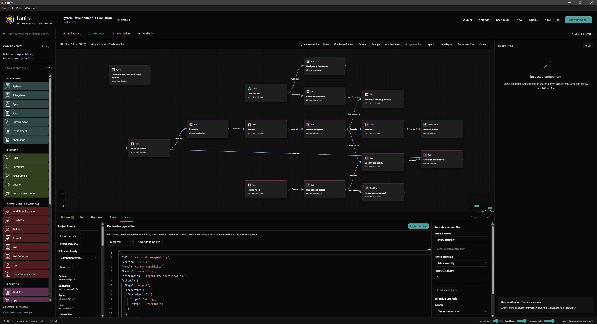

# Lattice

Lattice is an experimental desktop application for visually specifying software systems, including agentic workflows. Architecture, behavior, information, and validation views share one model, so a change to an entity is reflected across its views.

Use Lattice to describe responsibilities, interfaces, workflows, constraints, and acceptance criteria, then export a specification for implementation. Lattice specifies systems; it does not execute them.

**Windows x64 | React / TypeScript / Electron | [MIT license](LICENSE)**



## Features

- Four connected diagram views with nested systems, visual containers, automatic layout, and snapping.
- Typed components and relationships, reusable assemblies, and versioned definition packages.
- Deterministic validation with separate human review records and traceable exports.
- Associated workspace files, a text editor, hash-checked saves, and explicit change reconciliation.
- Light and dark themes, local fonts, configurable colors, tooltips, and a searchable user guide.
- Reviewed AI proposal tools backed by a **simulated provider**. Live AI integration is not available; no API key is needed.

Specification checks and human design reviews do not establish that an implementation is correct or that runtime permissions are enforced.

## Run from source

Development and desktop packaging target **Windows x64**. Use Node **24.22.2**, npm **11.11.0**, and Git for repository inspection and the test suite. From the root of a cloned checkout or an extracted source archive, run:

```powershell
npm ci
node node_modules/electron/install.js
npm run dev
```

Dependency lifecycle scripts are disabled in `.npmrc`. The explicit Electron installation command downloads the pinned desktop runtime; it is the only required installation script. Keep `package-lock.json` unchanged for reproducible dependency resolution. Building a Windows package may also download packaging tools.

To launch an existing production build locally, use `npm run build` followed by `npm start`.

## Create a specification

1. Add a system from the toolbox or open the synthetic development example.
2. Add components and connect them. Edit shared properties in Inspector and inspect the four views.
3. Save to an empty project folder outside the application checkout.
4. Optionally attach workspace roots and associate text files with components. Review proposed file changes before applying them.
5. Inspect findings and review records, then preview and export a specification package.

Press **F1** for the user guide, **Ctrl+K** for component insertion, **Ctrl+S** to save, and **Ctrl+,** for appearance settings. Diagram layout history and semantic undo are separate.

## Data and privacy

Projects are stored locally as `project.json`, view layouts, and definition copies. Workspace-root locations, appearance preferences, and recovery data stay in application-local storage. Git inspection is read-only.

Lattice has no implemented live AI provider, telemetry service, cloud synchronization, or updater. Development dependency installation downloads packages and the Electron runtime.

Exports include the semantic model, specification, implementation brief, traceability, validation report, and a manifest. The Codex export profile can also generate project instructions and skills from the model. Export filtering excludes known credential fields and machine paths, but cannot recognize every secret written in free-form text. Review previews and exported files before sharing them. Associated files are referenced unless you explicitly include supporting text.

Existing project files are not migrated automatically from other storage schemas. Text editing supports UTF-8 and UTF-8 BOM with LF or CRLF; binary content, mixed newlines, invalid encoding, and files above 5 MiB are read-only.

## Build a Windows ZIP

```powershell
npm run package:win
```

The command checks the source set, builds the application and dependency notices, and creates `dist/Lattice-0.3.1-win-x64.zip` with publishing disabled.

Extract the ZIP and run `Lattice.exe`. Keep the extracted files together, including `LICENSE`, `THIRD_PARTY_NOTICES.txt`, and the Electron/Chromium notices. Builds are **unsigned** and may trigger Windows trust prompts. Installers, automatic updates, and code signing are not provided.

`npm run release:source` creates `dist/lattice-0.3.1-source.tar.gz` from the reviewed source candidate list, including this README and the MIT license. It excludes Git history, dependencies, build output, personal project state, local instructions, and generated test evidence. System `tar` is required.

Interface and favicon icons use `public/icons/icon-on-light.svg` or `icon-on-dark.svg` for the selected theme. Window icons use the matching 256 px PNG. The Windows executable uses `icon-on-dark-512.png`.

Use **System connections** in the canvas toolbar to show or hide edges with a System at either endpoint; they start hidden. **Graph tooltips** starts off and can be enabled in the toolbar or Settings → Tooltips. These preferences persist on this computer without changing the project model or exports. Help for controls, toolbox items and inspector fields remains available.

## Development and verification

```powershell
npm run verify
npm run format:check
npm run release:history
```

`verify` runs type checking, lint, unit tests, the performance fixture, a production build, and Electron tests. Individual commands are `typecheck`, `lint`, `test`, `test:performance`, and `test:e2e`.

Electron tests require a Windows desktop session. A host test creates a temporary junction to check workspace isolation. The packaged smoke test is skipped unless `LATTICE_PACKAGED_EXE` points to an executable extracted from the built ZIP; run that check separately as described in the [release guide](docs/releasing.md).

The Windows [GitHub Actions workflow](.github/workflows/ci.yml) installs the pinned toolchain, checks formatting, source boundaries and dependency advisories, runs verification, and tests the extracted Windows package. It has read-only repository permissions and no publishing step.

See [contributing](CONTRIBUTING.md), [implementation contracts and known schema limits](docs/contracts.md), [manual release preparation](docs/releasing.md), and [security and privacy](SECURITY.md).

## Project Status

Lattice is experimental. Windows x64 is the supported build target; macOS and Linux packages are not provided. Live AI integration, automatic updates, and code signing are not implemented.

## License

Lattice's original source is available under the [MIT license](LICENSE), copyright © 2026 Nat Garnenez. Dependencies retain their own licenses; see [third-party software and source information](docs/third-party.md).
